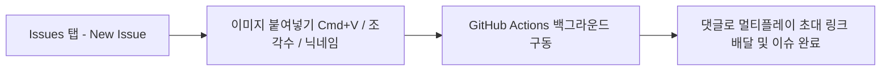
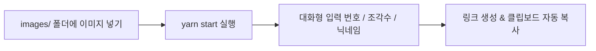

# 🧩 AutoJigsawPuzzle (멀티플레이어 지그소 퍼즐 생성기)

> **이미지만 올리면 친구들과 함께 즐길 수 있는 직소 퍼즐 멀티플레이 방을 자동으로 생성해 주는 자동화 도구입니다.**  
> **GitHub Issues(온라인 웹/모바일)**와 **로컬 터미널(CLI)** 두 가지 방식을 모두 지원합니다.

[](https://nodejs.org/)
[](https://playwright.dev/)
[](https://github.com/features/actions)
[](LICENSE)

---

## 🌟 1. GitHub Issues로 퍼즐 만들기 (추천 ⭐ 모바일/PC 어디서나)

별도 터미널 실행 없이, 스마트폰이나 웹 브라우저에서 이미지 첨부만으로 퍼즐 초대 링크를 발급받을 수 있습니다.



### 📱 사용 순서
1. 저장소 상단의 **`Issues`** 탭으로 이동합니다.
2. 초록색 **`New issue`** 버튼을 클릭하고 **[퍼즐 생성 요청]** 템플릿의 **`Get started`**를 클릭합니다.
3. **이슈 제목**: 이력 관리를 위해 **원하는 제목으로 자유롭게 변경**해도 됩니다. (예: `[이브이] 500피스`, `디지몬 퍼즐 2026-09-04`)
4. **본문 작성**:
   - **퍼즐 이미지**: 입력창에 이미지를 마우스로 끌어다 놓거나(Drag & Drop), 클립보드 이미지 붙여넣기(`Cmd + V` / `Ctrl + V`), 또는 웹 이미지 URL을 입력합니다.
   - **퍼즐 조각 수**: 기본값 `500` (원하는 조각 수 입력)
   - **방장 닉네임**: 기본값 `또갈통`
5. 하단의 **`Submit new issue`** 버튼을 클릭합니다.
6. **약 30~50초 후** 등록된 이슈에 봇이 **친구 초대 멀티플레이 링크 댓글**을 자동으로 달아주고 이슈가 종료(Closed)됩니다! 🎉

---

## 💻 2. 로컬 터미널에서 실행하기 (CLI 방식)

내 컴퓨터에서 직접 실행하고 링크를 클립보드로 바로 복사받고 싶을 때 사용합니다.



### 실행 방법
```bash
# 1. 의존성 설치 (최초 1회)
yarn install
npx playwright install chromium

# 2. images/ 폴더에 이미지 파일(.jpg, .png 등) 넣기

# 3. 프로그램 실행
yarn start
```
* 처리가 완료되면 **멀티플레이 게임 링크가 터미널에 출력되며 클립보드에 자동 복사**됩니다.
* 사용 완료된 이미지는 `images/used/` 폴더로 자동 이동됩니다.

---

## ⚙️ 설정 기본값 (Defaults)

| 설정 항목 | 기본값 | 설명 |
| :--- | :--- | :--- |
| **퍼즐 조각 수** | **`500` 조각** | 미입력 시 기본 500조각으로 생성 |
| **방장 닉네임** | **`또갈통`** | 미입력 시 기본 닉네임 적용 |
| **이미지 호스팅** | `Postimages API` | 고화질 직접 링크(Hotlink)로 변환 |
| **브라우저 모드** | `Headless` | 백그라운드 자동화로 빠르고 조용하게 실행 |

---

## 📂 디렉토리 구조 (Directory Structure)

```plaintext
jigsaw/
├── .github/
│   ├── ISSUE_TEMPLATE/
│   │   └── create_puzzle.md   # 깃허브 이슈 생성 마크다운 템플릿
│   └── workflows/
│       └── generate_puzzle.yml# GitHub Actions 자동화 워크플로우
├── images/                    # 로컬 실행용 이미지 디렉토리
│   └── used/                  # 사용 완료된 이미지 자동 보관 디렉토리
├── scripts/
│   └── create_puzzle.js       # GitHub Actions 연동 실행 스크립트
├── index.js                   # 로컬 대화형 CLI 메인 스크립트
├── package.json               # 프로젝트 설정 및 패키지 의존성
├── yarn.lock                  # 의존성 잠금 파일
└── README.md                  # 프로젝트 안내 문서
```
