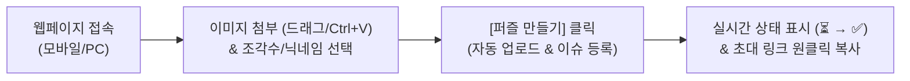

# 🧩 AutoJigsawPuzzle (멀티플레이어 직소 퍼즐 생성기 & 웹 매니저)

> **이미지만 올리면 친구들과 함께 즐길 수 있는 직소 퍼즐 멀티플레이 방을 자동으로 생성해 주는 도구입니다.**  
> 비개발자도 쉽게 쓸 수 있는 **GitHub Pages 웹 매니저**, **GitHub Issues**, **로컬 터미널(CLI)** 세 가지 방식을 모두 지원합니다.

[](https://nodejs.org/)
[](https://playwright.dev/)
[](https://github.com/features/actions)
[](https://pages.github.com/)

---

## 🌐 1. GitHub Pages 웹 매니저로 사용하기 (비개발자 추천 ⭐⭐⭐)

GitHub 계정이나 마크다운 작성법을 몰라도, 전용 웹페이지에서 **이미지 첨부 + 조각 수 버튼 클릭**만으로 퍼즐을 만들고 역대 퍼즐 목록을 한눈에 관리할 수 있습니다.

- **접속 주소**: `https://puzzle.hoeng.site/` *(Cloudflare CNAME 연동 커스텀 도메인)*



### ✨ 주요 기능
1. **초간편 이미지 등록**: 파일 선택, 마우스 드래그 앤 드롭, 클립보드 붙여넣기(`Ctrl+V` / `Cmd+V`), 외부 이미지 URL 입력 모두 지원
2. **조각 수 빠른 선택**: `100`, `300`, `500`, `1000` 조각 프리셋 버튼 및 직접 입력 지원
3. **실시간 진행 상태 표시**: 퍼즐 생성 중(`⏳ 생성 대기 중...`) 상태를 실시간으로 감지하여 완료되는 즉시 **게임방 초대 링크 모달**을 띄워줍니다.
4. **역대 퍼즐 목록 갤러리**: 지금까지 생성된 모든 퍼즐의 **썸네일 이미지, 조각 수, 방장 닉네임, 생성 일시**를 카드 형태로 모아보고, 언제든 **멀티플레이 초대 링크 / 1인용 링크를 원클릭 복사**할 수 있습니다.

---

## 🔐 2. 저장소 Public 전환 & GitHub Secrets 설정 가이드

저장소를 **Public**으로 전환하더라도 API Key와 토큰이 코드에 노출되지 않도록 모든 인증값은 **GitHub Secrets**로 분리되어 있습니다.

### 1단계: GitHub Fine-grained Personal Access Token 발급 (`PUZZLE_GITHUB_TOKEN`)
비개발자가 웹페이지에서 별도 GitHub 로그인 없이 이슈를 자동 생성하려면 최소 권한 토큰이 필요합니다.
1. GitHub 우측 상단 프로필 클릭 → **Settings** → 좌측 하단 **Developer settings** → **Personal access tokens** → **Fine-grained tokens** 이동
2. **Generate new token** 클릭
3. **Repository access**: `Only select repositories` 선택 후 `AutoJigsawPuzzle` 저장소 선택
4. **Permissions** → **Repository permissions** 펼치기:
   - **Contents**: `Read and write` 로 설정 *(웹에서 업로드한 퍼즐 이미지를 `uploads` 브랜치에 저장하기 위함)*
   - **Issues**: `Read and write` 로 설정 *(퍼즐 생성 이슈 등록 및 상태 관리 위함)*
5. 발급된 토큰(`github_pat_...`)을 복사합니다.

### 2단계: 저장소 GitHub Secrets 등록
저장소 상단 **Settings** 탭 → 좌측 **Secrets and variables** → **Actions** → **New repository secret** 버튼을 눌러 아래 항목을 등록합니다.

| Secret 이름 | 필수 여부 | 입력할 값 설명 |
| :--- | :---: | :--- |
| **`POSTIMAGES_API_KEY`** | **필수** | Postimages API 키 (기존 로컬 `.env`의 `POSTIMAGES_API_KEY` 값) |
| **`PUZZLE_GITHUB_TOKEN`** | **필수** | 1단계에서 발급한 GitHub Fine-grained PAT (`Issues: Read & Write`) |
| `POSTIMAGES_O` | 선택 | Postimages `o` 파라미터 (미등록 시 기본 호환값 사용) |
| `POSTIMAGES_M` | 선택 | Postimages `m` 파라미터 (미등록 시 기본 호환값 사용) |
| `PROXY_URL` | 선택 | Cloudflare Workers 프록시([`cloudflare-worker/worker.js`](file:///Users/zero/workspace/private/AutoJigsawPuzzle/cloudflare-worker/worker.js))를 사용할 경우 워커 URL |

### 3단계: GitHub Pages 활성화
1. 저장소 상단 **Settings** 탭 → 좌측 **Pages** 메뉴 이동
2. **Build and deployment** 항목의 **Source**를 **`GitHub Actions`**로 변경합니다.
3. 상단 **Actions** 탭 → **🌐 Deploy GitHub Pages Web UI** 워크플로우 선택 → 우측 **Run workflow** 버튼을 클릭하면 약 20초 뒤 웹페이지 배포가 완료됩니다!

---

## 🌟 3. GitHub Issues에서 직접 퍼즐 만들기

1. 저장소 상단의 **`Issues`** 탭 → **`New issue`** → **[🧩 퍼즐 생성 요청]** 템플릿의 **`Get started`** 클릭
2. **퍼즐 이미지** 붙여넣기, **퍼즐 조각 수**(기본 `500`), **방장 닉네임**(기본 `또갈통`) 확인 후 **`Submit new issue`** 클릭
3. 약 30~50초 후 봇이 **멀티플레이 초대 링크 댓글**을 달아주고 이슈를 자동 완료(Close)합니다.

---

## 💻 4. 로컬 터미널에서 실행하기 (CLI 방식)

내 컴퓨터에서 직접 실행하고 링크를 클립보드로 바로 복사받고 싶을 때 사용합니다.

```bash
# 1. 의존성 설치 (최초 1회)
yarn install
npx playwright install chromium

# 2. 환경변수 파일 설정 (.env.example 참고)
cp .env.example .env
# .env 파일 내 POSTIMAGES_API_KEY 값을 설정합니다.

# 3. images/ 폴더에 이미지 파일(.jpg, .png 등) 넣기 후 실행
yarn start
```

---

## 📂 디렉토리 구조 (Directory Structure)

```plaintext
AutoJigsawPuzzle/
├── .github/
│   ├── ISSUE_TEMPLATE/
│   │   └── create_puzzle.md       # GitHub 이슈 생성 마크다운 템플릿
│   └── workflows/
│       ├── generate_puzzle.yml    # 이슈 등록 시 퍼즐 자동 생성 봇 워크플로우
│       └── deploy_pages.yml       # GitHub Pages 웹 매니저 자동 배포 워크플로우
├── docs/                          # GitHub Pages 정적 웹 애플리케이션 (비개발자용 UI)
│   ├── index.html                 # 메인 반응형 웹 화면
│   ├── style.css                  # 모던 스타일시트
│   ├── config.js                  # 런타임 설정 템플릿 (배포 시 Secrets 안전 주입)
│   └── app.js                     # 이미지 업로드, 이슈 생성, 실시간 목록 폴링 로직
├── cloudflare-worker/
│   └── worker.js                  # (선택) 토큰 완전 은닉용 Cloudflare Workers 프록시
├── images/                        # 로컬 CLI 실행용 이미지 디렉토리
│   └── used/                      # 사용 완료된 이미지 자동 보관 디렉토리
├── scripts/
│   └── create_puzzle.js           # GitHub Actions 연동 실행 스크립트
├── .env.example                   # 환경변수 설정 예시 파일
├── index.js                       # 로컬 대화형 CLI 메인 스크립트
├── package.json                   # 프로젝트 설정 및 패키지 의존성
└── README.md                      # 프로젝트 안내 문서
```
