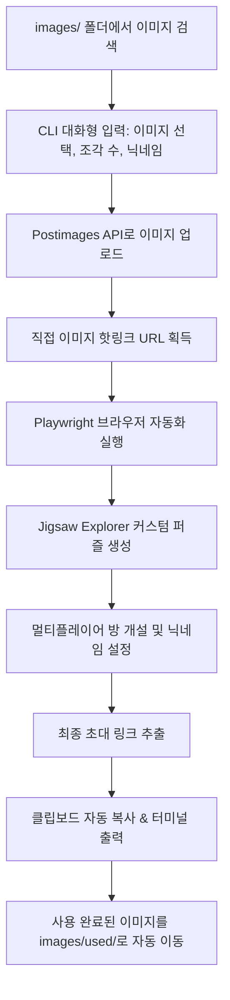
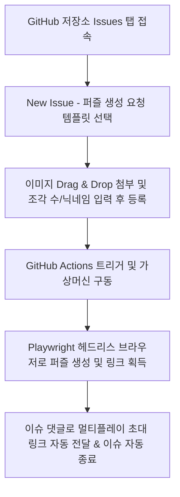

# 🧩 AutoJigsawPuzzle (postImageWithJigsawPuzzle)

> **로컬 이미지를 업로드하고 친구들과 함께 즐길 수 있는 직소 퍼즐 멀티플레이 방을 자동으로 생성해 주는 CLI 자동화 도구입니다.**

[](https://nodejs.org/)
[](https://playwright.dev/)
[](LICENSE)

---

## 📌 주요 기능 (Features)

1. **자동 이미지 호스팅 업로드**:
   - 로컬의 이미지 파일을 Postimages API를 통해 Base64 형태로 업로드하고 직접 접근 가능한 핫링크(Hotlink)를 획득합니다.
2. **Jigsaw Explorer 퍼즐 생성 자동화**:
   - Playwright(Headless Chromium)를 활용하여 [Jigsaw Explorer](https://www.jigsawexplorer.com/) 사이트에 접속, 지정한 조각 수의 퍼즐을 자동으로 생성합니다.
3. **멀티플레이어 게임 링크 즉시 발급**:
   - 1인용 단축 링크 생성 후 자동으로 멀티플레이어 모드를 활성화하고, 지정한 닉네임으로 방을 개설하여 초대 링크를 발급받습니다.
4. **원클릭 클립보드 자동 복사**:
   - 발급된 멀티플레이어 게임 초대 링크는 OS 클립보드에 자동으로 복사되어 바로 친구들에게 공유할 수 있습니다.
5. **사용 완료 이미지 자동 보관**:
   - 생성이 성공적으로 완료된 원본 이미지는 `images/used/` 디렉토리로 자동 이동하여 중복 사용을 방지하고 깔끔하게 관리합니다.
6. **GitHub Issues & Actions 온라인 생성 지원**:
   - 로컬 CLI뿐만 아니라, 깃허브 저장소의 `Issues` 탭에서 이미지를 드래그 앤 드롭으로 업로드하면 GitHub Actions가 자동으로 멀티플레이 퍼즐 링크를 생성해 댓글로 배달합니다.

---

## 🔄 동작 워크플로우 (Workflow)

### 1. 로컬 터미널 실행 (CLI 방식)


### 2. 깃허브 온라인 이슈 실행 (GitHub Actions 방식)


---

## 📂 디렉토리 구조 (Directory Structure)

```plaintext
jigsaw/
├── .github/
│   ├── ISSUE_TEMPLATE/
│   │   └── create_puzzle.yml  # 깃허브 이슈 생성 입력 폼 템플릿
│   └── workflows/
│       └── generate_puzzle.yml # 이슈 트리거 GitHub Actions 자동화
├── images/             # 로컬 실행용 원본 이미지 디렉토리
│   └── used/           # 사용 완료된 이미지 보관 디렉토리
├── scripts/
│   └── create_puzzle.js # GitHub Actions 연동용 퍼즐 생성 스크립트
├── index.js            # 로컬 대화형 CLI 스크립트
├── package.json        # 의존성 패키지 및 스크립트 설정
├── yarn.lock           # Yarn 의존성 잠금 파일
└── README.md           # 프로젝트 안내 문서
```

---

## 🛠️ 요구 사항 및 설치 (Installation)

### 1. 사전 요구 사항
- **Node.js**: v18 이상 권장
- **패키지 매니저**: `yarn` 또는 `npm`

### 2. 패키지 설치
```bash
# Yarn 사용 시
yarn install

# 또는 npm 사용 시
npm install
```

### 3. Playwright Chromium 브라우저 설치 (최초 1회)
```bash
npx playwright install chromium
```

---

## 🚀 사용 방법 (Usage)

### 1. 이미지 준비
퍼즐로 제작하고 싶은 이미지 파일(`.jpg`, `.jpeg`, `.png`, `.gif`, `.webp`)을 `images/` 폴더에 넣어줍니다.

### 2. 프로그램 실행
```bash
npm start
# 또는
node index.js
```

### 3. 대화형 입력 진행
프로그램이 실행되면 터미널에서 다음 순서대로 값을 입력합니다:

1. **업로드할 이미지 번호 선택**
   - `images/` 폴더에 위치한 이미지 목록과 용량이 표시됩니다. 해당 번호를 입력합니다.
2. **퍼즐 조각 갯수 입력**
   - 원하는 퍼즐 조각 수를 입력합니다. (엔터 시 기본값: `300`)
3. **멀티플레이 닉네임 입력**
   - 퍼즐 방장의 닉네임을 입력합니다. (엔터 시 기본값: `또갈통`)

### 4. 결과 확인 및 공유
- 처리가 완료되면 터미널에 **1인용 단축 링크**와 **멀티플레이 게임 링크**가 표시됩니다.
- 초대 링크는 **클립보드에 자동으로 복사**되므로 `Ctrl + V` (Mac: `Cmd + V`)로 메신저 등에 즉시 붙여넣어 공유할 수 있습니다.
- 사용된 이미지는 `images/used/` 디렉토리로 이동됩니다.

---

## ⚙️ 설정 기본값 (Defaults)

| 항목 | 기본값 | 설명 |
| :--- | :--- | :--- |
| 퍼즐 조각 수 | `300` | 엔터 입력 시 기본 300조각으로 설정 |
| 방장 닉네임 | `또갈통` | 엔터 입력 시 기본 닉네임 적용 |
| 브라우저 모드 | `Headless` (백그라운드) | 브라우저 창이 뜨지 않고 백그라운드에서 자동 처리 |
| 이미지 보관 위치 | `images/used/` | 생성 완료 후 원본 이미지 자동 이동 |

---

## 📦 기술 스택 (Tech Stack)

- **Language**: JavaScript (ESM)
- **Automation & Crawling**: `@playwright/test`
- **Utility**: `clipboardy` (클립보드 복사), `colors` (터미널 컬러 포맷)
- **APIs**: Postimages Upload API, Jigsaw Explorer Web Service
